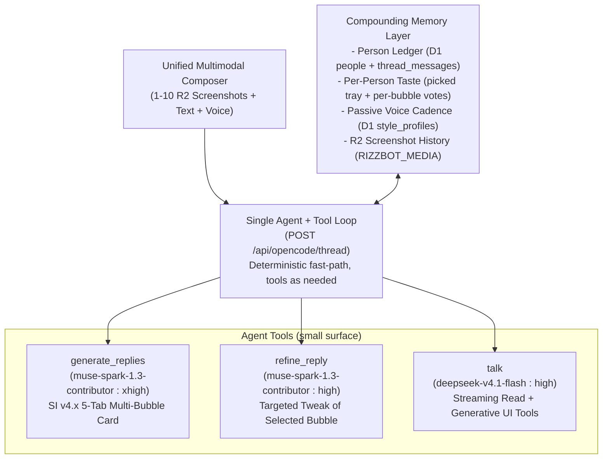

# 10 — Conversational App Vision (Phase 2 Blueprint: Unified Thread Architecture)

> **Status**: Phase 2 Architectural Blueprint (Execute **after** Plans `010`–`014` are shipped and verified in production).
> **Foundation Reused**: Built directly on top of the OpenCode Go backend (`functions/api/opencode/*`), Cloudflare R2 media pipeline (`RIZZBOT_MEDIA`, `functions/api/media.ts`, `<R2Image />`), and Passive Voice Learning (`style_profiles.learned_samples`, `style_profiles.cadence_notes`) introduced in Plans `010`–`014`.
>
> **Locked decisions (Nov 2026, single-user hobby scope, ~10 users max)**:
> - NO roleplay anywhere (cut as creepy — no simulator, no "test this reply on them").
> - NO separate router agent or intent categories. One agent with tools; deterministic heuristics pick the fast path, the model calls tools as needed mid-turn.
> - "One conversation = one session" is OUR abstraction (`thread_id` + assembled history), not a dependency on OpenCode server sessions. The agentic loop (model → tool → model, ≤N rounds) runs inside a single backend call.
> - Voice learning stays sneaky: abstract tells only, invisible in UI; proof shows in output quality.
> - No end-session action exists: summaries compact opportunistically (~15 turns / token threshold), new chats inherit universal memory, threads link to people retroactively.
> - Builds ALONGSIDE Quick Mode as a new Chat surface. Quick Mode is frozen and untouched.
> - Agentic = multiple tool calls + thinking per turn, progress shown as human status lines, never narrated machinery.

---

## 1. Executive Vision: Why Unify the 5 Siloed Tabs?

Today, Rizzbot splits the user's dating life across 5 separate navigation tabs (`Quick Mode`, `Practice`, `Coach / Therapist`, `My Voice`, `History`). While each mode is useful in isolation, real human dating emergencies don't fit neatly into rigid tabs:

1. **Real user journeys cross mode boundaries inside a single 3-minute session**:
   - A user uploads 3 screenshots to get a quick reply (`Quick Mode`) → asks *"wait why did she bring up her ex on image 2?"* (coach) → says *"make option #2 on Playful a bit shorter and tease her about being late"* (refine) → picks lines across tones into the tray → sends.
   - In a siloed tab architecture, the user has to copy-paste context between modes, re-upload screenshots, and re-select the person/stage every single time. (Roleplay-style simulation is explicitly out of scope — cut as creepy, not a missing feature.)
2. **The Phase 2 Target Experience**:
   - Transform Rizzbot into a **ChatGPT-style unified conversational workspace** centered around **People Threads** (e.g., *"Maya — Hinge"*, *"Priya — Snapchat"*, or *"General Wingman Thread"*).
   - Inside any thread, the user has **one universal multimodal composer** (1–10 screenshots via R2 WebP, text, or voice recording) and a single intelligent wingman that dynamically routes each turn to the right specialized OpenCode Go workflow and renders **inline interactive UI cards** directly inside the chat stream.

---

## 2. Architecture Overview



---

## 3. Core Pillars of the Unified Conversational App

### Pillar 1: Unified Multimodal Thread Composer
- **Single Input Bar at the Bottom of Every Thread**:
  - **Attach / Paste 1–10 Screenshots**: Uses `optimizeImageFile()` (`1280px` WebP `0.80`) and uploads to `RIZZBOT_MEDIA` (`r2:quick/${uid}/...`) via `POST /api/media` (Plan 011).
  - **Voice Note Button**: Records and converts to 16kHz mono WAV (`useVoiceRecorder.ts`) and transcribes via `mimo-v2.6-flash` (`POST /api/voice/transcribe`, Plan 014).
  - **Relationship Stage & Person Pill**: Persistent header pill at the top of the thread (`talking`, `dating`, `complicated`, etc.) so the user sets it once per person instead of on every prompt.
  - **Optional Quick-Intent Override Chips**: Above the composer (`Auto`, `Give me replies`, `Decode subtext`) — defaults to `Auto` so deterministic heuristics pick the fast path (screenshots attached → replies; message references the previous card → refine; otherwise talk) unless the user taps a specific chip. No LLM classifier, no extra latency.

### Pillar 2: Single Agent + Tool Loop (no router agent, no intent categories)

One agent handles every turn. Deterministic heuristics pick the fast path for free (screenshots attached → replies; message references the previous card → refine; otherwise talk), and the model calls tools mid-turn as needed — model → tool → model, up to N rounds inside a single `POST /api/opencode/thread` call. "One conversation = one session" is our abstraction (`thread_id` + assembled history), not a dependency on server-side sessions.

1. **`generate_replies` (screenshots attached or user pastes a message asking what to reply)**:
   - Runs `muse-spark-1.3-contributor` (`xhigh`) with the current Quick SI (v4.x line).
   - Renders an **Inline 5-Tab Reply Card** (`<ToneRail />` + `<ReplyHeroCard />` + `<FriendSummaryCard />` + `<PickedTray />`) directly inside the assistant message bubble.
   - Simultaneously fires `triggerPassiveVoiceLearning()` in the background to extract the user's right-side/Me bubbles.
2. **`refine_reply` (user replies to an inline Reply Card, e.g., *"make Smooth #1 shorter"* or *"don't mention Friday yet"*)**:
   - Passes the previous Reply Card JSON + the user's refinement instruction to `muse-spark-1.3-contributor` (`high`).
   - Renders a compact **Refined Reply Card** with 3 updated variations matching the user's tweak without losing the earlier screenshot context.
3. **`talk` (user asks a question about dynamics, flags, timing, or vents without asking for immediate copy-paste texts)**:
   - Streams a conversational response via `deepseek-v4.1-flash` (`high`, `POST /api/opencode/stream`) with access to the inline generative UI tools (`Red_Green_Flag_Audit`, `Communication_Rewrite`, `No_Contact_Recovery_Plan`, `Prompt_Follow_Up_Choices`).
4. **Memory tools (called silently mid-turn, never narrated)**:
   - `recall_person` / `update_person` — read/write the person ledger (summary, what worked, language mix).
   - `note_voice` — abstract cadence observations about how the *user* texts (never verbatim quotes); feeds the same `cadenceNotes` pipeline voice-learn uses.
   - `save_memory` — global facts ("exam season") vs session-scoped context.

### Pillar 3: Compounding Personalization & Conversational `MyVoice` Onboarding
- **Retire the Static 6-Question Multiple-Choice Quiz**:
  - Replace the static quiz in `MyVoiceScreen.tsx` with:
    1. **Zero-Click Passive Screenshot Learning** (`Plan 013`) as the primary engine.
    2. **3-Turn Conversational Calibration Mini-Chat** for brand-new users with zero screenshots: Rizzbot sends 3 realistic texts (*"be honest did you forget about our plans tonight"*, *"i just saw the craziest thing remind me to tell you later"*, *"Wait are you always this trouble"*) and asks the user to type their natural 1-line reply to each.
  - Because the user types their *own* words (instead of clicking developer-written multiple-choice buttons), Rizzbot immediately captures authentic casing, punctuation, length, and dry/warm register on day one.
- **Per-Person Memory Ledger**:
  - Every thread tied to a `person_id` maintains a rolling 4-sentence `relationship_summary` in D1 (`people.notes` / `threads.context_summary`): inside jokes, what topics already came up, whether she texts in Hinglish, and which reply tabs (`real`, `playful`, `bold`) the user previously copied or thumbs-upped for that specific person.
- **Per-Person Taste (strongest signal in the system)**:
  - The picked-lines tray + per-bubble thumbs already record tone + variation + bubble per pick. In threads, every pick/copy is the revealed preference that seeds that person's taste profile — stronger than any thumbs-up. New threads for the same person bias tabs, bubble length, and opener style toward what previously got picked or copied *for her specifically*.

### Pillar 4: Human Feel + Continuity (locked rules)

- **First paint fast, tools quiet.** Stream text deltas the moment they exist (NDJSON `text` + `functionCalls` events, as `/api/opencode/stream` already emits). Tool activity surfaces as human status lines ("checking your history with her…", "reworking that line…") — never tool names, never narrated machinery ("I've updated your profile" is banned).
- **One voice.** Lowercase-leaning, no bullet-point therapy speak unless asked for structure. No announcements of learning; proof shows in output quality over weeks.
- **No end-session action exists.** Threads are eternal — the user leaves mid-conversation and picks up anytime. Person summaries compact opportunistically (~15 turns or token threshold, cheap model, background). New chats inherit universal memory (cadence + global facts); threads link to a person retroactively when one is named.
- **Proactive suggestions, never proactive messages.** Session debriefs ("she warmed up after bubble 2, bold flopped — noted") and silence re-engagers are offered in-thread. The agent never acts outward.
- **Quick Mode is frozen.** The unified Chat surface builds alongside it as a new tab, reusing composer pieces, `R2Image`, voice recorder, and the V2 reply cards verbatim. No shared-screen refactors as part of Phase 2.

---

## 4. Phase 2 D1 Database Schema Additions (`d1_migrations/008_conversational_threads.sql`)

Phase 2 introduces two new D1 tables (`threads` and `thread_messages`) while keeping `sessions`, `people`, `style_profiles`, and `feedback_signals` intact:

```sql
-- Migration 008: Unified Conversational Threads & Inline UI Cards
CREATE TABLE IF NOT EXISTS threads (
  id TEXT PRIMARY KEY,
  uid TEXT NOT NULL,
  person_id TEXT,
  title TEXT NOT NULL,
  stage TEXT DEFAULT 'talking',
  context_summary TEXT DEFAULT '',
  last_message_at TEXT NOT NULL,
  created_at TEXT NOT NULL
);

CREATE INDEX IF NOT EXISTS idx_threads_uid_last_msg
  ON threads(uid, last_message_at DESC);

CREATE TABLE IF NOT EXISTS thread_messages (
  id TEXT PRIMARY KEY,
  thread_id TEXT NOT NULL,
  uid TEXT NOT NULL,
  role TEXT NOT NULL, -- 'user' | 'assistant'
  intent TEXT,        -- 'reply' | 'refine' | 'talk' (which fast path served the turn)
  text_content TEXT DEFAULT '',
  images TEXT DEFAULT '[]',       -- JSON array of R2 keys ("r2:quick/uid/...")
  card_payload TEXT DEFAULT NULL, -- JSON string of QuickAdviceResponse V2 or Tool Call widget payload
  model_used TEXT,
  created_at TEXT NOT NULL,
  FOREIGN KEY (thread_id) REFERENCES threads(id) ON DELETE CASCADE
);

CREATE INDEX IF NOT EXISTS idx_thread_messages_thread
  ON thread_messages(thread_id, created_at ASC);
```

---

## 5. Staged Migration Roadmap from Phase 1 (Plans 010–014) to Phase 2

Because Plans `010`–`014` are modularly designed with Phase 2 in mind, **zero work from Plans 010–014 is thrown away**:

| Phase 1 Component (Plans 010–014) | How Phase 2 Reuses It Directly |
| :--- | :--- |
| `functions/api/opencode/quick.ts` & `QUICK_MODE_SI_V4.x` (Plan 010) | Powers the `generate_replies` tool and the `refine_reply` path inside unified threads |
| `functions/api/media.ts`, `RIZZBOT_MEDIA` R2 bucket & `<R2Image />` (Plan 011) | Stores and renders all `thread_messages.images` (`r2:quick/${uid}/...`) with zero base64 bloat |
| `<ToneRail />`, `<ReplyHeroCard />`, `<FriendSummaryCard />` & `<PickedTray />` (Plan 012 + later) | Rendered directly as the interactive `card_payload` component inside assistant turns |
| `functions/api/voice/learn.ts` & `style_profiles.cadence_notes` (Plan 013) | Runs automatically on every screenshot uploaded to a thread composer; `note_voice` tool extends it to chat text |
| `functions/api/opencode/stream.ts` & `functions/api/voice/transcribe.ts` (Plan 014) | Powers the `talk` streaming turns and the thread composer's voice input button |
